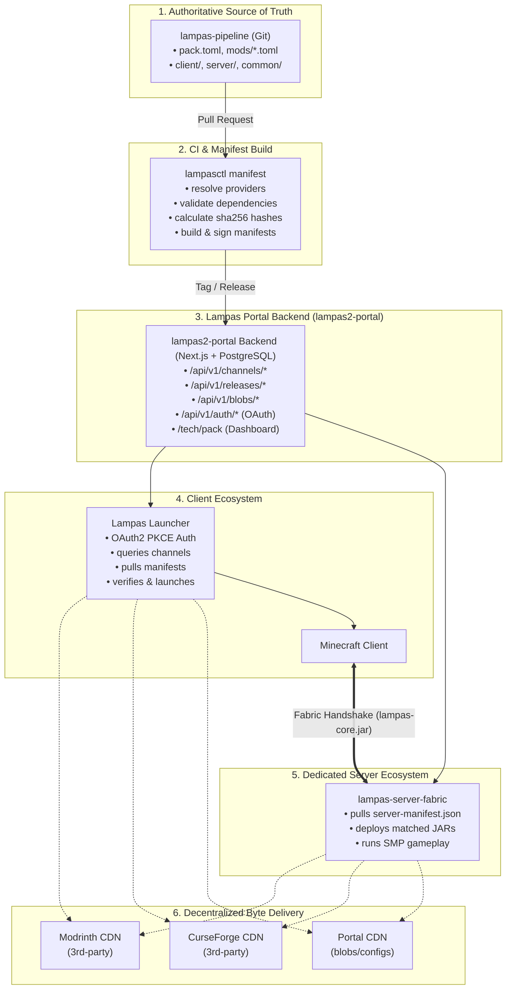
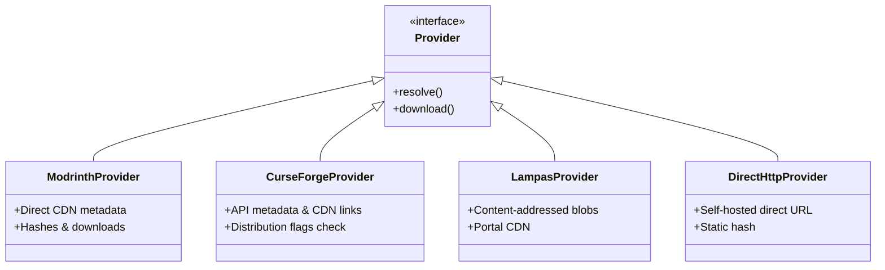
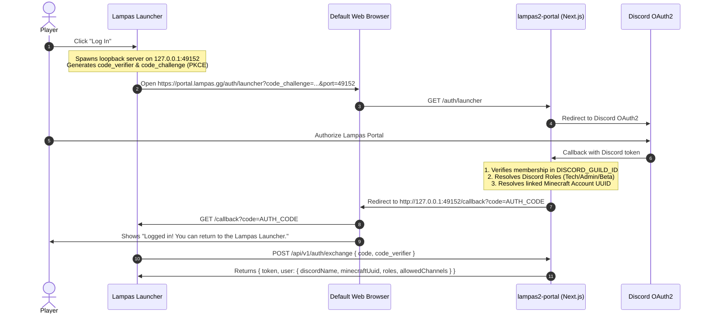
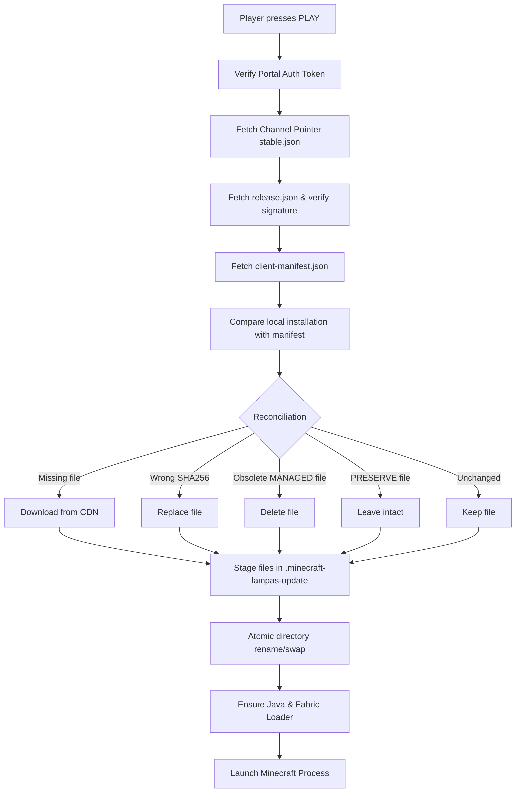
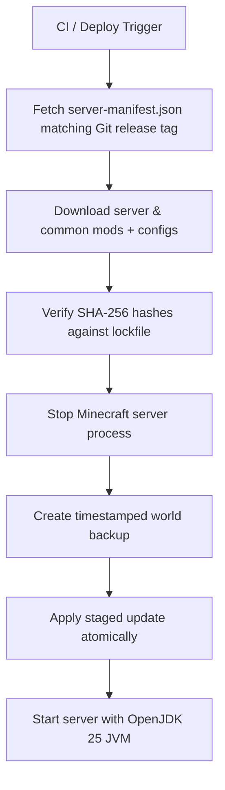
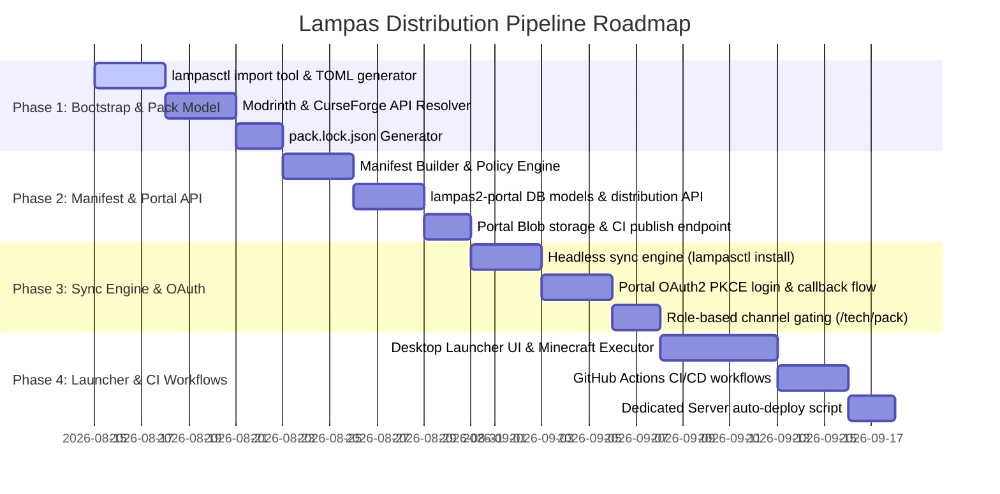

# Lampas Modpack Distribution & Portal Ecosystem Plan

## 1. Goals & Vision

The Lampas distribution system provides a fully managed, deterministic Minecraft SMP experience without relying on CurseForge/Modrinth modpack imports or runtime auto-sync mods like AutoModpack.

The system ensures that:

- **Single Source of Truth**: Client and server releases are derived from the exact same Git repository configuration.
- **Centralized Control & Zero Drift**: Lampas dictates the exact Minecraft, Fabric, mod, config, and script versions players and servers run.
- **Decentralized Byte Delivery**: Third-party mod binaries are pulled directly from original CDNs (Modrinth / CurseForge), while Lampas-owned files (configs, custom mods, scripts) are delivered via the Lampas Portal CDN.
- **Web Portal Integration**: Authentication, channel gating, release management, and content delivery are powered by **`lampas2-portal`**.
- **Secure Web OAuth2 Flow**: The desktop launcher delegates login to the web portal via OAuth2 PKCE, eliminating embedded secrets and enforcing Discord guild membership and role-based permissions in real-time.
- **Granular File Policies**: Player-owned files (keybinds, options, shaders, screenshots) survive updates while pack-owned files remain strictly synchronized.
- **Immutable Releases & Instant Rollbacks**: Releases are immutable; promotion (`dev` $\to$ `beta` $\to$ `stable`) and rollbacks are instantaneous channel pointer updates.
- **Standalone Launcher**: The launcher owns authentication, synchronization, verification, and game execution.

---

## 2. Workspace & Repository Ecosystem

The Lampas ecosystem spans three primary repositories and reference client instances:

| Component | Path | Role |
| :--- | :--- | :--- |
| **Pipeline & Pack Source** | `C:\Users\markj\source\repos\lampas-pipeline` | Authoritative pack definitions, mod TOMLs, configs, schemas, CI workflows, and `lampasctl` CLI. |
| **Portal & Distribution Backend** | `C:\Users\markj\source\repos\lampas2-portal` | Next.js + PostgreSQL backend for Discord OAuth2 PKCE authentication, release distribution API, blob CDN, and Tech control dashboard. |
| **Dedicated Minecraft Server** | `C:\Users\markj\source\repos\lampas-server-fabric` | Production/staging Fabric Minecraft server built and deployed from `server-manifest.json`. |
| **Reference Client Instance** | `C:\Users\markj\AppData\Roaming\PrismLauncher\instances\26.2-fabric\minecraft\mods` | Live reference client mod setup (~101 mods) used for bootstrap imports and testing. |

---

## 3. High-Level Architecture



---

## 4. Repository Structure (`lampas-pipeline`)

```text
lampas-pipeline/
├── pack/
│   ├── pack.toml                 # Root pack descriptor (MC version, loader version, pack version)
│   │
│   ├── mods/                     # Human-maintained declarative mod definitions
│   │   ├── fabric-api.toml
│   │   ├── better-combat.toml
│   │   ├── lootr.toml
│   │   └── ...
│   │
│   ├── client/                   # Client-only assets and configuration overrides
│   │   ├── config/
│   │   └── resourcepacks/
│   │
│   ├── server/                   # Server-only configurations and scripts
│   │   ├── config/
│   │   └── defaultconfigs/
│   │
│   └── common/                   # Shared configurations, datapacks, scripts
│       ├── config/
│       ├── datapacks/
│       └── kubejs/
│
├── launcher/                     # Standalone Lampas Launcher (UI + Sync Engine)
│   └── ...
│
├── tools/                        # Pipeline CLI & Tooling (lampasctl)
│   ├── resolver/                 # Modrinth & CurseForge API resolver
│   ├── importer/                 # Bootstrapper for existing JAR folders
│   ├── validator/                # Fabric metadata & dependency graph checker
│   ├── manifest-builder/         # Generates client/server manifests & lockfiles
│   └── sync-engine/              # Core headless verification and sync engine
│
├── schemas/                      # JSON Schemas for schema versioning
│   ├── manifest.schema.json
│   └── release.schema.json
│
├── .github/
│   └── workflows/
│       ├── validate-pack.yml     # PR validation & smoke testing
│       ├── release-pack.yml      # Immutable release builder & portal publisher
│       └── update-check.yml      # Scheduled daily upstream update checker
│
├── PLAN.md                       # Master Architecture & Implementation Plan
└── README.md
```

---

## 5. Pack & Mod Definitions

Pack definitions are human-maintained TOML files defining desired state rather than transient download URLs.

### `pack/pack.toml`
```toml
[pack]
name = "Lampas SMP"
version = "2.14.0"
minecraft = "1.21.1"

[loader]
type = "fabric"
version = "0.16.14"

[launcher]
minimum_version = "1.3.0"
protocol = 27
```

### Mod Definitions (`pack/mods/*.toml`)

#### Modrinth Example (`pack/mods/better-combat.toml`)
```toml
name = "Better Combat"
side = "both"  # "client" | "server" | "both"

[provider]
type = "modrinth"
project_id = "5sy6g3kz"
version_id = "fD89Xz12"
```

#### CurseForge Example (`pack/mods/lootr.toml`)
```toml
name = "Lootr (Fabric)"
side = "both"

[provider]
type = "curseforge"
project_id = 361276
file_id = 5892341
```

#### Lampas-Hosted Custom Binary (`pack/mods/lampas-core.toml`)
```toml
name = "Lampas Core"
side = "both"

[provider]
type = "lampas"
file = "custom/lampas-core-1.0.0.jar"
```

> **Strict Rule**: Never use `"latest"` in published releases. Every release pins immutable provider IDs and hashes.

---

## 6. Provider Abstraction & API Restrictions

The resolver abstracts provider details through a common provider interface:



### CurseForge 3rd-Party Distribution Handling
CurseForge allows mod authors to set `allowModDistribution = false`. When `lampasctl resolve` detects a mod with distribution disabled:
1. If the mod license permits redistribution, CI archives the binary into `lampas2-portal` blob storage (Hybrid Model).
2. If redistribution is prohibited, CI alerts the maintainer to seek an alternative (e.g., Modrinth version or direct author approval).

---

## 7. Dependency Validation & Fabric Metadata

`lampasctl validate` inspects the internal `fabric.mod.json` of all resolved JARs:

1. **Root & Jar-in-Jar (JiJ) Inspection**: Recursively checks `/META-INF/jars/` so embedded libraries (e.g., Cloth Config, Cardinal Components) are not falsely marked as missing.
2. **Compatibility Graph**:
   - Confirms all mods match Minecraft `1.21.1` and the target Fabric Loader version.
   - Verifies `depends`, `breaks`, `conflicts`, and `environment` tags.
   - Fails PR builds if client-only mods are included in `server` scope or server-only mods in `client` scope.
   - Detects duplicate mod IDs or conflicting class mixins.

---

## 8. Lockfile & Published Manifests

### 1. `pack.lock.json` (Source Lockfile committed to Git)
```json
{
  "schema": 1,
  "packVersion": "2.14.0",
  "minecraft": "1.21.1",
  "loader": "0.16.14",
  "artifacts": {
    "better-combat": {
      "provider": "modrinth",
      "projectId": "5sy6g3kz",
      "versionId": "fD89Xz12",
      "filename": "bettercombat-fabric-2.3.1.jar",
      "size": 930628,
      "sha256": "91abb38ef4...",
      "side": "both"
    }
  }
}
```

### 2. `release.json` (Root Release Descriptor published to Portal)
```json
{
  "schemaVersion": 1,
  "pack": "lampas-smp",
  "version": "2.14.0",
  "minecraft": "1.21.1",
  "loader": {
    "type": "fabric",
    "version": "0.16.14"
  },
  "minimumLauncherVersion": "1.3.0",
  "protocol": 27,
  "gitCommit": "a83cb91...",
  "created": "2026-08-15T12:00:00Z",
  "clientManifest": "/api/v1/releases/2.14.0/client-manifest",
  "serverManifest": "/api/v1/releases/2.14.0/server-manifest"
}
```

### 3. `client-manifest.json` & `server-manifest.json`
```json
{
  "schemaVersion": 1,
  "pack": "lampas-smp",
  "version": "2.14.0",
  "target": "client",
  "files": [
    {
      "path": "mods/bettercombat-fabric-2.3.1.jar",
      "size": 930628,
      "hashes": {
        "sha256": "91abb38ef4..."
      },
      "download": {
        "url": "https://cdn.modrinth.com/data/5sy6g3kz/versions/fD89Xz12/bettercombat-fabric-2.3.1.jar",
        "provider": "modrinth"
      },
      "policy": "MANAGED"
    },
    {
      "path": "config/bettercombat.json",
      "size": 4120,
      "hashes": {
        "sha256": "7fac831d..."
      },
      "download": {
        "url": "/api/v1/blobs/7fac831d...",
        "provider": "lampas"
      },
      "policy": "MANAGED"
    }
  ]
}
```

---

## 9. File Policies & Local Safety

Every manifest item defines a strict policy:

| Policy | Ownership | Launcher Behavior | Examples |
| :--- | :--- | :--- | :--- |
| **`MANAGED`** | Lampas Pack | Download, verify SHA-256, replace if changed, delete if removed from release. | `mods/**`, `config/gameplay/**`, `datapacks/**` |
| **`PRESERVE`** | Player / Local | Never overwrite or delete. Remains intact across pack updates. | `options.txt`, `screenshots/**`, `saves/**`, `shaderpacks/**` |
| **`OPTIONAL`** | Player Choice | Installed on demand (e.g. shaders, client UI helpers) and kept up to date if present. | `Iris`, `Zoomify`, `ShulkerBoxTooltip` |
| **`GENERATED`** | Local Runtime | Ephemeral state maintained by launcher. | `.lampas/installation.json`, runtime logs |

### Hardcoded Directory Safeguards
Even if a manifest misconfiguration occurs, the launcher hardcodes absolute immunity for:
`saves/**`, `screenshots/**`, `resourcepacks/**`, `shaderpacks/**`, `logs/**`, `crash-reports/**`, and `options.txt`.

---

## 10. Web Portal Backend Integration (`lampas2-portal`)

**`lampas2-portal`** ([`C:\Users\markj\source\repos\lampas2-portal`](file:///C:/Users/markj/source/repos/lampas2-portal)) serves as the authentication provider, distribution backend, and release control center.

### A. Database Schema (`prisma/schema.prisma`)

```prisma
enum ReleaseStatus {
  DRAFT
  DEV
  BETA
  STABLE
  REVOKED
}

enum ChannelName {
  dev
  beta
  stable
}

model PackRelease {
  id                     String        @id @default(cuid())
  version                String        @unique
  minecraftVersion       String
  fabricVersion          String
  minimumLauncherVersion String
  protocolVersion        Int
  status                 ReleaseStatus @default(DRAFT)
  gitCommit              String?
  clientManifest         Json
  serverManifest         Json
  signature              String?
  createdAt              DateTime      @default(now())
  updatedAt              DateTime      @updatedAt
}

model ChannelPointer {
  channel        ChannelName @id
  targetVersion  String
  updatedAt      DateTime    @updatedAt
}

model StoredBlob {
  sha256         String   @id
  size           Int
  mimeType       String?
  storagePath    String   // S3/R2 key or local blob path
  createdAt      DateTime @default(now())
}

model LauncherAuthCode {
  id            String    @id @default(cuid())
  code          String    @unique
  codeChallenge String
  userId        String
  user          User      @relation(fields: [userId], references: [id], onDelete: Cascade)
  expiresAt     DateTime
  used          Boolean   @default(false)
  createdAt     DateTime  @default(now())
}

model LauncherSession {
  id           String    @id @default(cuid())
  token        String    @unique
  userId       String
  user         User      @relation(fields: [userId], references: [id], onDelete: Cascade)
  lastUsedAt   DateTime  @default(now())
  expiresAt    DateTime
  createdAt    DateTime  @default(now())
}
```

### B. Portal API Surface

| Endpoint | Method | Auth | Description |
| :--- | :--- | :--- | :--- |
| `/api/v1/channels/[channel]` | `GET` | Optional Token | Returns channel pointer (gated: `dev`/`beta` require verified roles). |
| `/api/v1/releases/[version]` | `GET` | Public | Returns `release.json` with signature. |
| `/api/v1/releases/[version]/client-manifest` | `GET` | Public | Returns `client-manifest.json`. |
| `/api/v1/releases/[version]/server-manifest` | `GET` | Server Secret | Returns `server-manifest.json`. |
| `/api/v1/blobs/[hash]` | `GET` | Public | Serves content-addressed configs, scripts, and custom jars. |
| `/api/v1/releases/publish` | `POST` | CI API Key | Ingests new releases, manifests, and blobs from CI builds. |
| `/api/v1/auth/exchange` | `POST` | Public (PKCE) | Exchanges PKCE authorization code for launcher session token. |
| `/api/v1/auth/verify` | `POST` | Bearer Token | Verifies existing launcher session token on startup. |

### C. Tech Control Dashboard (`/tech/pack`)
Restricted to users with `DISCORD_ROLE_TECH`:
1. **One-Click Promotion**: Promote releases (`dev` $\to$ `beta` $\to$ `stable`) with zero rebuilds.
2. **Instant Killswitch (Revoke)**: Mark compromised or buggy releases as `REVOKED`; launchers refuse to launch and roll back immediately.
3. **Release Diff Viewer**: Visually inspect mod changes, config diffs, and download size deltas.
4. **Player Diagnostics Log Ingest**: View submitted launcher crash diagnostics from players.

---

## 11. Launcher Web Authentication Flow (OAuth2 PKCE)

Authentication is handled entirely via `lampas2-portal` using the **OAuth2 PKCE Loopback Flow**:



### Dual-Layer Authentication Model
1. **Layer 1 (Lampas Portal Session)**: Authorizes pack sync, verifies Discord guild whitelist, and grants access to release channels (`stable`, `beta`, `dev`).
2. **Layer 2 (Microsoft MSA Session)**: Standard Minecraft authentication passed directly to the Minecraft JVM (`--accessToken`, `--uuid`) for online-mode server validation (`sessionserver.mojang.com`).

---

## 12. Launcher Synchronization Algorithm



### Content-Addressed Local Cache
The launcher stores downloaded artifacts in `cache/sha256/<hash-prefix>/<hash>`. Multiple profiles or game instances share the cache, preventing redundant downloads.

---

### Zero Third-Party Launcher Dependencies Mandate
The Lampas Launcher is **100% standalone and self-sufficient**. It does **NOT** depend on PrismLauncher, CurseForge App, MultiMC, or the official Minecraft Launcher.

1. **Self-Contained Game Environment**:
   - Manages its own isolated game root in `.minecraft-lampas`.
   - Provisions Minecraft 26.2 client JAR (`piston-data.mojang.com`).
   - Downloads all 174 core Mojang (`fastutil`, `log4j`, `gson`, `guava`, `authlib`, `brigadier`, `netty`, etc.) and LWJGL 3.4.1 runtime libraries.
   - Extracts native binaries (`.dll`, `.so`, `.dylib`) directly into `.minecraft-lampas/natives/`.
   - Downloads Fabric Loader `0.19.3` and Intermediary `26.2` (`maven.fabricmc.net`).
2. **Direct KnotClient JVM Execution**:
   - Dynamically constructs the complete Java classpath string containing all runtime libraries and the client JAR.
   - Automatically provisions and spawns the **OpenJDK 25 (`java-runtime-epsilon`)** runtime invoking `net.fabricmc.loader.impl.launch.knot.KnotClient` with optimized G1GC JVM parameters.
   - Streams live game output (`stdout`/`stderr`) directly into the launcher's built-in console without relying on external wrappers.

---

## 13. Dedicated Server Pipeline (`lampas-server-fabric`)

The dedicated server at [`C:\Users\markj\source\repos\lampas-server-fabric`](file:///C:/Users/markj/source/repos/lampas-server-fabric) uses `server-manifest.json`:



---

## 14. Protocol Mod (`lampas-core.jar`)

A lightweight Fabric mod installed on both client and server:
- Performs a protocol handshake upon connection.
- Verifies pack semantic version and protocol number.
- Replaces cryptic disconnect messages with clean instructions:
  > *"Your Lampas Modpack is outdated (v2.13.0 vs Server v2.14.0). Please launch the game through the Lampas Launcher to auto-update."*

---

## 15. CLI Tooling (`lampasctl`)

`lampasctl` is the single CLI binary driving local development and CI:

```bash
# Bootstrap & Migration
lampasctl import --client <prism_mods_dir> --server <server_mods_dir>

# Pack Maintenance
lampasctl resolve                 # Resolves upstream IDs, fetches hashes, generates pack.lock.json
lampasctl validate                # Validates Fabric metadata, JiJ dependencies, and loader compatibility
lampasctl diff 2.13.0 2.14.0      # Shows added/modified/removed mods and download size deltas
lampasctl manifest                # Generates client-manifest.json and server-manifest.json
lampasctl check-updates           # Daily bot check for new upstream releases

# Distribution & Installation
lampasctl publish --channel dev   # Publishes release and uploads blobs to lampas2-portal
lampasctl install stable ./game   # Headless synchronization engine testing
```

---

## 16. Phased Implementation Roadmap



### Phase 1: Bootstrapping & Pack Model
1. Build `lampasctl import` to scan [`lampas-server-fabric/mods`](file:///C:/Users/markj/source/repos/lampas-server-fabric/mods) and [`PrismLauncher mods`](file:///C:/Users/markj/AppData/Roaming/PrismLauncher/instances/26.2-fabric/minecraft/mods), hash JARs, query Modrinth/CurseForge APIs, and generate initial `pack/mods/*.toml` files.
2. Implement the provider resolver and generate `pack.lock.json`.

### Phase 2: Manifests & Portal Distribution Backend
1. Implement `client-manifest.json` and `server-manifest.json` generation with SHA-256 hashes and file policies.
2. Add Prisma models (`PackRelease`, `ChannelPointer`, `StoredBlob`) and API endpoints in [`lampas2-portal`](file:///C:/Users/markj/source/repos/lampas2-portal).
3. Implement the `/tech/pack` admin dashboard for release promotion, revocation, and diff inspection.

### Phase 3: Headless Sync Engine & Web OAuth
1. Implement the headless installer engine in `lampasctl install`.
2. Add the PKCE OAuth2 loopback login handler to `lampas2-portal` (`/auth/launcher` $\to$ `http://127.0.0.1:[port]/callback`).
3. Validate Discord guild membership and role-gated channel access (`dev`/`beta`/`stable`).

### Phase 4: Desktop Launcher & CI/CD Pipelines
1. Build the standalone desktop launcher wrapping the sync engine and Microsoft MSA game launcher.
2. Implement GitHub Actions workflows (`validate-pack.yml`, `release-pack.yml`, `update-check.yml`).
3. Deploy and verify synchronized runs between the launcher client and dedicated server.

---

## 17. Success Criteria

The pipeline is verified when:
1. **Headless Fresh Install**: `lampasctl install stable ./test-instance` produces a playable Minecraft 1.21.1 / Fabric installation matching `server-manifest.json`.
2. **Deterministic Update**: Bumping a single mod version in Git updates only that specific JAR and modified config in the local instance.
3. **Preservation**: Player-customized `options.txt` and keybinds survive consecutive pack updates without resets.
4. **Instant Rollback**: Shifting `stable` channel from `2.0.1` back to `2.0.0` in the portal dashboard rolls back the client and server cleanly on the next sync.
5. **Role Gating & OAuth**: Non-tech players cannot access `dev` channel manifests; banned or non-guild Discord accounts are rejected at login.