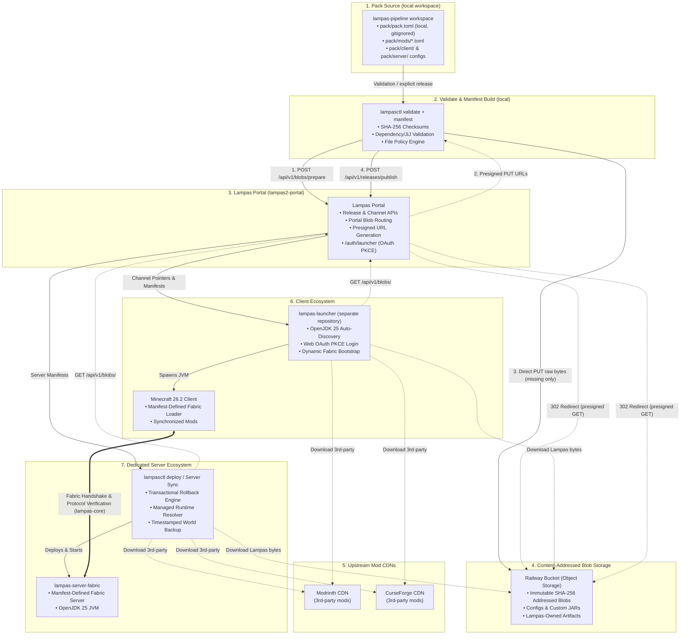
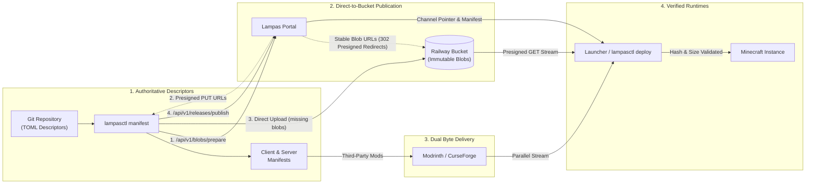
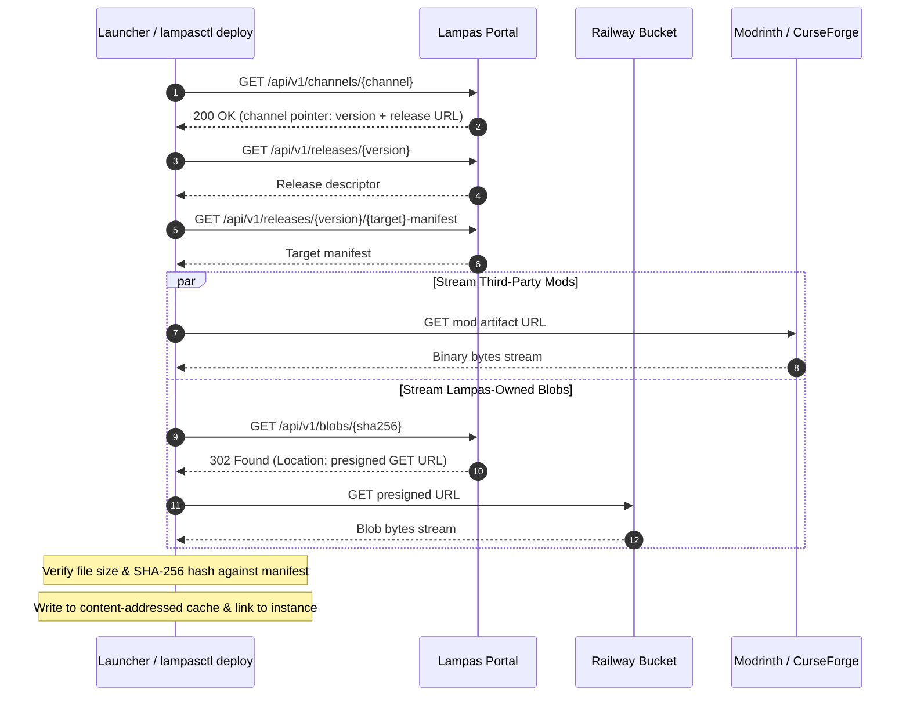
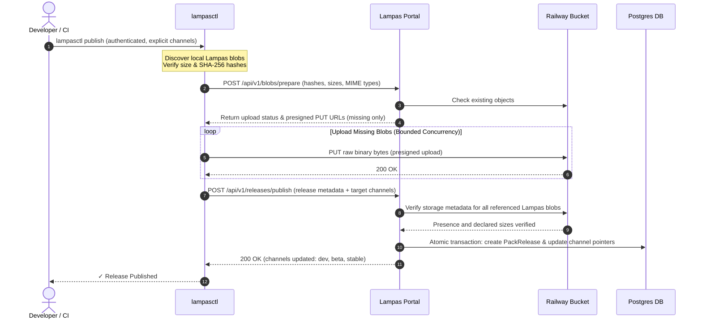

# ⚡ Lampas Modpack Distribution Pipeline

[](https://minecraft.net)
[](https://fabricmc.net)
[-orange.svg)](https://adoptium.net)
[](https://bun.sh)
[](LICENSE)

The **Lampas Pipeline** is a declarative, immutable Minecraft modpack distribution engine and release automation framework designed for high-performance SMP environments.

It guarantees **zero drift between clients and dedicated servers** by managing both from a single Git repository, eliminating runtime synchronization mods and third-party launcher dependencies.

---

## 🌟 Key Architecture & Tenets



1. **Deterministic Single Source of Truth**: Every client and server release is strictly generated from declarative TOML descriptors committed to Git.
2. **Decentralized Byte Delivery**: Third-party artifacts are downloaded directly from upstream CDNs (Modrinth / CurseForge). Lampas-owned artifacts (configs, custom JARs, resource packs) use immutable SHA-256 content addressing stored in Railway Bucket, with the Portal providing stable blob URLs and redirecting clients to short-lived presigned downloads.
3. **Content-Addressed Blob Storage & Deduplication**: Lampas-owned files are keyed by SHA-256. Publishing an unchanged artifact does not upload it again; only hashes missing from object storage are transferred.
4. **Standalone Desktop Launcher**: 100% independent of PrismLauncher, CurseForge App, or MultiMC. Bundles automatic **OpenJDK 25 (`java-runtime-epsilon`)** discovery and direct `KnotClient` JVM execution.
5. **Web OAuth2 PKCE Authentication**: Desktop login delegates to the web portal via a browser loopback OAuth2 flow, linking Discord roles, SMP whitelist verification, and official Minecraft Java UUIDs in one click.
6. **Zero-Downtime Rollbacks & Gated Channels**: Channels (`stable`, `beta`, `dev`) are mutable pointers to immutable releases, so promotion and rollback are atomic pointer updates.
7. **Upstream Update Checker**: `lampasctl check-updates` scans all pack mods, can apply updates and writes a Markdown changelog with `--markdown <path>`. It runs locally; no CI job schedules it.
8. **Authoritative Loader Contract**: `pack.toml [loader]` defines the mod loader required by the release. Generated locks, manifests, and release descriptors derive their loader metadata from this definition and must never independently choose a loader version. Releases are verified against Fabric Meta to guarantee Minecraft/Loader compatibility before publication.

---

## 🔄 Distribution Flow



### 1. Publication Flow (`lampasctl publish`)
1. **Discover & Verify**: `lampasctl` scans manifests for `provider = "lampas"` artifacts and computes local SHA-256 hashes and file sizes.
2. **Prepare**: Sends `POST /api/v1/blobs/prepare` to the Portal. The Portal checks object storage and returns presigned PUT URLs *only* for missing SHA-256 hashes.
3. **Direct Upload**: `lampasctl` uploads missing blobs directly to Railway Bucket via presigned PUT with bounded concurrency and retry logic.
4. **Publish Release**: Sends `POST /api/v1/releases/publish` with release metadata and target channels.
5. **Atomic Commit**: The Portal verifies that all referenced blobs exist in object storage with the declared sizes, records the release, and atomically updates the target channel pointers.

### 2. Client & Server Sync Flow



1. **Release Resolution**: The Launcher or `lampasctl deploy` queries `/api/v1/channels/<channel>` for a pointer, then fetches the immutable release descriptor and target manifest for the returned version.
2. **Parallel Downloads**:
   - Upstream mods stream directly from Modrinth or CurseForge.
   - Lampas-owned artifacts query the stable Portal blob URL (`/api/v1/blobs/<sha256>`), receive a `302` redirect to a short-lived presigned GET URL on Railway Bucket, and stream the raw bytes.
3. **Integrity Validation**: Every downloaded file is verified against its declared size and SHA-256 hash before being added to the local content-addressed cache.
4. **Atomic Instance Reconciliation**: The runtime instance directory is updated atomically, removing obsolete files and linking verified artifacts.

---

## 📁 Repository Structure

```text
lampas-pipeline/
├── pack/                         # Local modpack authoring workspace (gitignored)
│   ├── pack.toml                 # Root pack descriptor (MC 26.2, Fabric 0.19.5, Pack vX.X.X, [portal], [launcher] (minimum_version, protocol), [launcher.play], [launcher.resourcepacks], [client].preserve)
│   ├── pack.lock.json            # Lockfile with pinned upstream version IDs & SHA-256 hashes
│   ├── mods/                     # Declarative mod TOML definitions
│   ├── custom/                   # Lampas-owned local JAR inputs
│   ├── resourcepacks/            # Declarative resource pack TOML definitions (e.g. lampas2.toml)
│   ├── shaderpacks/              # Declarative shader-pack TOML definitions
│   ├── common/                   # Shared configs, scripts, and assets (synced to both client & server)
│   ├── client/                   # Client-only mods and configs, plus seed files options.txt and servers.dat (PRESERVE)
│   ├── server/                   # Server-only mods and configs
│   ├── config-patches/           # Managed config patches (client.json)
├── manifest/                     # Generated release artifacts (gitignored)
│   ├── client-manifest.json      # Client distribution manifest
│   ├── server-manifest.json      # Dedicated server distribution manifest
│   └── release.json              # Canonical release descriptor
│
├── tools/lampasctl/              # High-performance pipeline CLI (Bun + TypeScript)
│   └── src/
│       ├── blob-publisher.ts     # Lampas blob discovery, verification, prepare + direct PUT
│       ├── checker.ts            # Concurrent upstream update checker for Modrinth/CurseForge
│       ├── config-patches.ts     # Config patch, protected-path & client preserve validation
│       ├── diff.ts               # Release & manifest visual diff tool
│       ├── launcher/             # Dedicated server launcher (host sizing, JVM flags, start command)
│       ├── manifest.ts           # Manifest builder for client/server distribution
│       ├── manifest-rules.ts     # Manifest schema & protected-path checks run before writing
│       ├── monitor/              # Server status monitor & Discord webhook alerts
│       ├── portal.ts             # Portal base URL resolution from --portal, pack.toml & defaults
│       ├── portal-compare.ts     # Generated manifests vs. the Portal channel release
│       ├── publisher.ts          # Release publication and multi-channel metadata publishing
│       ├── release-resolver.ts   # Remote Portal channel and release resolver
│       ├── resolver.ts           # Upstream API dependency resolver
│       ├── restart/              # Scheduled server restart sequencer & RCON client
│       ├── validator.ts          # Fabric metadata & JiJ integrity validator
│       ├── sync.ts               # Headless installation and server deployment engine
│       └── backup.ts             # World backup utility
│
├── tools/templates/              # Systemd unit & timer service templates
│   ├── lampas-server.service     # Dedicated server systemd unit (lampasctl start)
│   ├── lampas-server-restart.service # Scheduled restart systemd unit (lampasctl restart)
│   ├── lampas-server-restart.timer   # Systemd restart timer
│   └── lampas-discord-monitor.service # Discord status monitor unit (lampasctl monitor)
│
├── schemas/                      # JSON Schemas for pack, artifact, mod, config patch, lockfile, manifest, and release files
│
└── .github/workflows/
    └── release-lampasctl.yml     # Tagged lampasctl CLI builds, smoke tests, & GitHub release
```

> [!NOTE]
> **Gitignored Local Workspaces**: `pack/` and `manifest/` are local workspaces excluded from Git tracking via `.gitignore`. The repository tracks pipeline tooling, type schemas, systemd service templates, and CI automation. Modpack authoring and generated manifests live in local disk workspaces, and distribution is handled via immutable Portal releases.

---

## 🛠️ CLI Tooling (`lampasctl`)

`lampasctl` is the single CLI driving pack maintenance, validation, and deployment.

### 1. 1-Click Mod Management (`add` & `remove`)
Add or remove mods directly from the command line. Automatically detects project metadata, fetches latest compatible releases for Minecraft 26.2, updates `pack/mods/*.toml`, updates `pack.lock.json`, and rebuilds manifests in one step:

```bash
# Add a Modrinth mod (by slug, ID, or web URL)
bun run lampasctl add appleskin --side client
bun run lampasctl add 5sy6g3kz --side both
bun run lampasctl add https://modrinth.com/mod/sodium --side client

# Add a CurseForge mod (URL auto-detection, slug, project ID, or pinned file URL)
bun run lampasctl add https://www.curseforge.com/minecraft/mc-mods/appleskin
bun run lampasctl add appleskin --provider curseforge --side client
bun run lampasctl add 248787 --provider curseforge --version 5604145
bun run lampasctl add https://www.curseforge.com/minecraft/mc-mods/appleskin/files/5604145

# Add a custom local JAR
bun run lampasctl add ./my-custom-mod.jar --side both

# Remove a mod and re-synchronize manifests
bun run lampasctl remove appleskin
```

CurseForge authoring commands require a Core API key. Put it in the process environment or an ignored local `.env`
file; the key is used only by `lampasctl add`, `resolve`, `enrich`, and `check-updates` and is never written to pack
descriptors, lockfiles, or manifests:

```dotenv
CURSEFORGE_API_KEY=replace-with-your-curseforge-core-api-key
```

CurseForge artifacts remain on the upstream CDN. During resolution, `lampasctl` verifies the upstream SHA-1 and file
size, calculates the SHA-256/SHA-512 hashes required by Lampas, and keeps a verified local copy under the ignored
`.lampas/cache/curseforge/` directory. Projects that disable third-party distribution must be downloaded manually and
added as a local JAR instead.

### 2. Upstream Update Checker
Scan all pack mods concurrently against Modrinth / CurseForge APIs:
```bash
# Check for newer compatible releases on Minecraft 26.2
bun run lampasctl check-updates

# Automatically apply updates to pack/mods/*.toml
bun run lampasctl check-updates --apply

# Export Markdown changelog
bun run lampasctl check-updates --markdown update_summary.md

# Ignore configured blacklist rules for this invocation only
bun run lampasctl check-updates --force
bun run lampasctl check-updates --force --apply
```

Add typed rules to the root of `pack.toml`. A `mod_id` is the descriptor basename under `pack/mods/`, without `.toml`:

```toml
[[blacklist]]
scope = "mod_id"
id = "example-mod"
reason = "Temporarily excluded from upstream update scans"
```

Project and release rules name their provider and exact ID. CurseForge `version_id` values are integer file IDs. This example excludes the known SnappyTappy release `ER3HfIOr`:

```toml
[[blacklist]]
scope = "project_id"
provider = "modrinth"
id = "project-id"
reason = "Skip this project's update scan"

[[blacklist]]
scope = "version_id"
provider = "modrinth"
id = "ER3HfIOr"
reason = "SnappyTappy 26.3 is blocked for the Lampas 26.2 pack."

[[blacklist]]
scope = "version_id"
provider = "curseforge"
id = 123456
reason = "Known incompatible CurseForge file"
```

The checker skips matching descriptors and releases, then can choose the newest allowed release newer than the current pin; it never selects an older release. `lampasctl validate` rejects descriptor pins and lockfile artifacts that match blacklist rules. `check-updates --force` overrides blacklist filtering for that scan or application only; it still validates the policy, and `validate` has no bypass. `add` and `resolve` do not consult these rules.

### 3. Lockfile & Manifest Generation
```bash
# Resolve all TOML descriptors into pack.lock.json
bun run lampasctl resolve

# Validate Fabric metadata, dependencies, and environment constraints
bun run lampasctl validate

# Build client-manifest.json and server-manifest.json
bun run lampasctl manifest
```

`validate` reads `fabric.mod.json` from every `mods/*.jar` in the lockfile, and from the nested jar-in-jar entries each one lists under `jars`, and checks the client and server mod sets separately, as Fabric Loader would load them on that side. It fails on:

- a mod ID that two top-level jars declare, through `id` or `provides` (Fabric Loader loads only one of them), or that collides with a builtin mod;
- a top-level mod's `depends` entry that no loadable mod satisfies, or that two top-level mods constrain so that no single nested copy satisfies both;
- a top-level mod's `breaks` entry that matches a mod that has to load (a builtin, or every top-level jar with that ID);
- a `fabric.mod.json` that Fabric Loader's parser rejects: invalid JSON, an unsupported `schemaVersion`, an `id` or `provides` entry outside `[a-z][a-z0-9-_]{1,63}`, a missing `version`, an invalid `environment`, or a version predicate that does not parse. Other fields are not checked.

The builtin mods are `minecraft` (`[pack] minecraft`), `fabricloader` (`[loader] version`) and `java` (25). Version predicates follow Fabric Loader: `*`, `>=`, `<=`, `>`, `<`, `=`, `~`, `^`, `x` wildcards, space-separated terms ANDed and array entries ORed, with prerelease identifiers compared dot-wise and numeric parts numerically (`26.2-3.6.28` is newer than `26.2-3.6.6`).

The check follows Fabric Loader's resolver. Mods whose `environment` excludes a side are skipped on that side, with their nested jars; a dependency that only such a mod satisfies is not an error. Every top-level jar has to load. A nested mod loads only if its parent loads, no top-level or builtin mod has its ID, its own `depends` are satisfiable and no top-level `breaks` rule matches it; otherwise it is skipped silently, and only a mod that depends on it fails. Listed nested jars that are missing are skipped. The MixinExtras copy that Fabric Loader bundles is not modelled, so a `depends` on `mixinextras` needs a pack jar that bundles it; dependency overrides in `config/fabric_loader_dependencies.json` are not applied.

Jars come from `pack/<file>` for `lampas` artifacts, the `resolve` download cache (`.lampas/cache/modrinth|curseforge/...`) or `.lampas/cache/sha256/` next to `pack/` (the sha256 blob layout `sync` uses). A jar missing from all of them is downloaded into the cache and verified against the lockfile's SHA-256 and size, so the first `validate` on a fresh checkout needs network access. A `lampas` jar that no longer matches the lockfile fails validation; run `lampasctl resolve`. This check has no skip flag.

The Portal base URL baked into the release descriptor and server resource-pack URLs comes from `pack.toml`. Lampas blob URLs in the manifests stay relative (`/api/v1/blobs/<sha256>`); `deploy`, `start`, and `install` resolve them against their `--portal` value at sync time:

```toml
[portal]
base_url = "https://dev.lampas.town"
```

Precedence per command:

- `manifest`: `--portal` → `PORTAL_BASE_URL` → `[portal] base_url` → `https://portal.lampas.town`
- `enrich`: `--portal` → `[portal] base_url`; without either, it writes relative `/api/v1/...` URLs, as `add` and `remove` do.
- `add` / `remove`: only `[portal] base_url` (without one these write relative `/api/v1/...` URLs).
- `publish`: `--portal` → `PACK_PORTAL_URL` → `[portal] base_url`

Bun loads `.env` from the working directory, so `PACK_PORTAL_URL` or `PORTAL_BASE_URL` in `.env` overrides `[portal] base_url` like a shell variable. `publish` does not check that the manifests' URLs point at the Portal it publishes to; pass `--portal` explicitly when publishing. `lampasctl validate` rejects a malformed `base_url`. The `https://portal.lampas.town` fallback does not currently serve the Portal API (production is `https://dev.lampas.town`).

After writing the manifests, `manifest` compares them with the Portal that the `manifest` precedence above resolves (not `PACK_PORTAL_URL`) and prints the result. It shows the version each channel (`dev`, `beta`, `stable`) points to and whether the local version is published (`published (revoked)` when the Portal answers 410). The per-target (client, server) diff lists files added, removed, or updated and changed top-level fields, relative to the release the selected channel points to. A target whose file hashes and top-level fields match but whose manifest differs elsewhere (download URLs or file order) is reported as identical files with other metadata differing. `--channel dev|beta|stable` selects the channel (default `stable`); any other value skips the comparison with a warning. `--no-portal-diff` skips the comparison. When the local version is already published, the publish check compares the Portal's stored copy of that version with the local build, in full: both manifests (file order and download URLs count) and the stored release metadata (status, minimum launcher version, launch settings, loader and Minecraft versions, git commit, signature). If any of these differ, the summary names the differing fields and warns that publishing will be rejected (409) and to bump `[pack] version` in `pack.toml`. A revoked version (410) gets a warning that publishing will be rejected (409), without a field list. If nothing differs, it says publishing only moves channel pointers. Portal request failures are reported in the summary and never change the exit code.

### 4. Managed Configuration Patches
In addition to distributing whole files, Lampas supports **property-level / targeted config management** defined in `pack/config-patches/client.json`.

#### Ownership Levels:
- **`MANAGED`**: Lampas owns the whole file. Any local modifications are overwritten on synchronization, and obsolete files are deleted.
- **`PRESERVE`**: The mod or player owns the whole file. Lampas places initial defaults only if missing.
- **`CONFIG PATCH / enforce`**: The mod or player owns the file; Lampas owns selected values. If the player changes an enforced value, the next synchronization restores the Lampas value while preserving unrelated settings and comments.
- **`CONFIG PATCH / once`**: Lampas supplies selected initial values, then permanently relinquishes ownership to the player. Re-applies only when the patch revision is incremented.

> **Syntax Adapters**: The `adapter` property describes internal file syntax (`json`, `jsonc`, `yaml`, `toml`, `properties`, `ini`, `text`). **File extension does not determine the adapter.**

Supported adapters:
- **JSON / JSONC** (`adapter: "json"` / `"jsonc"`): Preserves unrelated whitespace, ordering, and comments.
- **YAML** (`adapter: "yaml"`): AST-based targeted editing preserving comments and formatting.
- **TOML** (`adapter: "toml"`): Conservative in-place scalar editor for tables and keys.
- **Java Properties** (`adapter: "properties"`): Line-preserving key-value modifier.
- **INI** (`adapter: "ini"`): Section/key modifier preserving comments.
- **Generic Text** (`adapter: "text"`): Literal search/replace with strict `expectedMatches` validation.

Patches cannot target player data or launcher state. `lampasctl validate` and `manifest` reject a patch on `options.txt`, `servers.dat`, `usercache.json`, `hotbar.nbt`, `realms_persistence.json`, `saves/`, `screenshots/`, `logs/`, `crash-reports/`, `.lampas/`, or `.lampas-moving-*`. A config patch also cannot target any whole-file entry, whether `MANAGED` or `PRESERVE`. The only exception is a keybind rebind of exactly `options.txt` (lowercase, with no `./`, no trailing slash): `adapter: "properties"`, `mode: "once"`, `missingFile: "defer"`, and only `set` operations on a single `key_*` path with a `key.keyboard.*` or `key.mouse.*` value. Such a rebind may accompany a PRESERVE `options.txt` from `pack/client/`. The launcher defers a keybind patch until its `key_*` lines exist in `options.txt`, and one missing line defers the whole patch, so `lampasctl` warns about patches that set several keys. Keep one keybind patch per mod. Launchers before 1.6.0 reject the patch (see the note on `[launcher].minimum_version` below).

Patch paths, `[client].preserve` entries, and client manifest paths follow the launcher's canonical path rules. A backslash is converted to `/`, and one trailing slash is dropped. Absolute paths, `.` and `..` segments, empty inner segments, segments ending in a dot or space, `:`, reserved device names, `__proto__`, `constructor` or `prototype` segments, control characters, DEL, and leading or trailing whitespace are errors. Client manifest paths that differ only by case are duplicates and are also errors. Emitted patch paths are canonical.

`pack/client/options.txt` and `pack/client/servers.dat` are seed-only defaults. `options.txt` carries keybind defaults and a `version:` line. `manifest` ships each file as `policy: "PRESERVE"`, so the launcher places it only when the player has no copy and never overwrites an existing one. These are the only launcher-protected files a client manifest may contain. Each must be the exact lowercase name under `pack/client/`. A different spelling, a non-PRESERVE policy, or a copy under `pack/common/` is rejected, even when listed in `[client].preserve`. A keybind patch may target `options.txt`, but no config patch may target `servers.dat`. Shipping these seeds requires launcher 1.6.0 or later (see the note on `[launcher].minimum_version` below).

`[client].preserve` in `pack.toml` lists other client files that ship as seed-only defaults, using the client-relative paths the client manifest emits, for example `preserve = ["options.amecs.key_modifiers.txt"]`. A listed file is PRESERVE, the same as the seed files: the launcher places it when the player has no copy and does not overwrite it. An entry may name a file under `pack/client/` or `pack/common/`, and matching is case-insensitive. Each entry must canonicalize, must match an existing client file, and must not be a launcher-protected path. The only protected paths that may appear are the exact seed paths `options.txt` and `servers.dat` from `pack/client/`, which are PRESERVE without an entry. A config patch cannot target a listed file, because a PRESERVE whole-file entry conflicts with a config patch the same way a MANAGED entry does. The launcher already applies PRESERVE to unprotected paths, so these entries do not need a newer launcher release.

Seed files and `options.txt` keybind patches need launcher 1.6.0 or later; the current pack sets `minimum_version = "1.6.0"`. `lampasctl` does not check this value against the features a pack uses, and writes `1.0.0` when the key is missing. `[launcher].minimum_version` does not protect older launchers. Launchers before 1.6.0 check the manifest schema before they check the version, so a pack that uses these rules shows those launchers a schema error, not an "update required" message, until the player updates the launcher. Launchers 1.6.0 and later check the version first and show the update message.

### 5. Release Diff Tool
Compare two manifests to inspect added, removed, or updated mods along with size deltas:
```bash
bun run lampasctl diff --from manifest/client-manifest.json --to manifest/server-manifest.json
```

### 6. Portal Release Publishing
Publish Lampas-owned artifacts to content-addressed object storage and atomically publish release metadata to [`lampas2-portal`](https://github.com/justbecauseph/lampas2-portal):

```bash
# Supply the token through the shell or CI secret store; never commit it.
# PACK_PORTAL_URL is optional when pack.toml defines [portal] base_url.
# PACK_PORTAL_URL (shell or .env) overrides pack.toml [portal] base_url; leave it unset to publish to base_url.
export PACK_PUBLISH_SECRET="<PUBLISH_TOKEN>"

# Publish release and simultaneously update all channels (dev, beta, stable):
bun run lampasctl publish

# Publish release to a specific channel:
bun run lampasctl publish --channel stable

# Publish release to multiple selected channels:
bun run lampasctl publish --channel dev,beta
```

#### Publishing Sequence:



#### Multi-Channel Publishing:
Invoking `lampasctl publish` without `--channel` (or with `--channel all`) publishes the release metadata once and atomically points `dev`, `beta`, and `stable` to the new release in a single operation. `--channel dev,beta` selects multiple channels. Publication is an explicit CLI operation; this repository does not currently contain a pack-tag publication workflow.

#### Publishing Guarantees:
- **Local Pre-validation**: Lampas blobs are verified for existence, byte size, and SHA-256 hash before any network transfer.
- **Content-Addressed Deduplication**: Existing SHA-256 objects in object storage are detected during prepare and never re-uploaded.
- **Direct Object Storage Upload**: Missing blobs upload directly to object storage via presigned PUT URLs.
- **Resilient Transfers**: Blob uploads use bounded concurrency and automatically retry transient network errors with backoff.
- **Integrity Gate**: Release metadata is committed only after the Portal verifies storage metadata for every referenced Lampas blob (existence and declared size).
- **Atomic Pointer Updates**: Release creation and channel pointer updates are committed in a single atomic database transaction.

#### Immutable Portal Publication Contract:
- `lampasctl publish` sends a bearer token to `/api/v1/blobs/prepare` and `/api/v1/releases/publish`; inline/base64 blob publishing is not supported.
- The prepare response identifies missing SHA-256 blobs and supplies short-lived presigned PUT URLs. Existing content-addressed objects are reused.
- The publish request contains the release metadata plus both schema-version-1 manifests. The Portal validates target/version parity, verifies every Lampas blob reference and declared size in object storage, then commits the release and requested channel pointers atomically.
- A release version is immutable: publishing different content under an existing version returns HTTP 409. Repeating an identical publication is idempotent and may move channel pointers without rewriting the release.
- Blob URLs are stable and content-addressed (`/api/v1/blobs/<sha256>`). The redirect response is not cached because its presigned `Location` expires; the underlying blob identity remains the SHA-256 path. Bucket credentials remain in the Portal; `lampasctl` receives only presigned upload URLs, and launchers/server deployments use public blob redirects without publish credentials.

#### Blob Storage Security Model:
- **Railway Bucket Credentials**: Held exclusively by the Portal backend.
- **`lampasctl`**: Requires `PACK_PUBLISH_SECRET`; receives short-lived presigned PUT URLs for missing hashes from `/api/v1/blobs/prepare`.
- **Launcher / Server Deployments**: Require zero S3 or publish credentials; interact only with public Lampas API endpoints and follow short-lived presigned GET redirects.

### 7. Headless Client / Server Sync
```bash
bun run lampasctl install --manifest manifest/client-manifest.json --target ./my-instance

# Force a complete SHA-256 verification instead of the metadata fast path
bun run lampasctl install --manifest manifest/client-manifest.json --target ./my-instance --verify full
```

Normal installs use the `fast` verification mode, which trusts unchanged size and modification-time metadata recorded in `.lampas/installation.json`. Use `--verify full` (or the launcher's Repair action) to hash every managed file.

---

## 🌐 Resource Pack Delivery Architecture & Direct Connect

Lampas implements two clearly separated delivery mechanisms for resource packs to ensure clean asset ownership, immutable CAS hashing, and zero duplicate downloads:

```text
Launcher-Managed Resource Packs
    ↓
Downloaded into <gameDir>/resourcepacks/
    ↓
SHA-256 validated by Lampas sync engine
    ↓
Enabled deterministically in options.txt

Server-Enforced Resource Pack
    ↓
Published as immutable CAS blob (SHA-256 + SHA-1)
    ↓
lampasctl deploy configures server.properties
    ↓
Minecraft native server-resource-pack protocol downloads on join
```

> [!IMPORTANT]
> **Dual-Delivery Prohibition**: Every managed resource pack has exactly one delivery owner. The same resource pack must never be configured for both launcher-local and server-resource-pack delivery.

### Current Configuration

| Resource Pack | Delivery Owner | Target Location | Configuration |
|---|---|---|---|
| `fa-player-extension` | **Launcher-Managed** | `<gameDir>/resourcepacks/` | `[launcher.resourcepacks] required = ["fa-player-extension"]` |
| `lampas2` | **Server-Enforced** | `server.properties` | `[server.resourcepack] artifact = "lampas2"` |

### 1. Launcher-Managed Resource Packs (`[launcher.resourcepacks]`)

Configured in `pack/pack.toml`:
```toml
[launcher.resourcepacks]
required = ["fa-player-extension"]
```
- **Sync & Verification**: The launcher synchronizes required packs into `<gameDir>/resourcepacks/` and validates their SHA-256 checksums. If a local file has modified content with the same filename, the launcher detects the hash mismatch, downloads the updated revision, and replaces it atomically.
- **Activation in `options.txt`**: Prior to bootstrapping the game, the launcher reconciles `options.txt`, deterministically placing managed packs into the active resource pack array while strictly preserving user-installed packs, ordering, comments, and game settings.
- **Cleanup**: If a pack is removed from the required set, it is cleanly removed from `options.txt` on the next launch.

### 2. Server-Enforced Resource Pack (`[server.resourcepack]`)

Configured in `pack/pack.toml`:
```toml
[server.resourcepack]
artifact = "lampas2"
required = true
prompt = '{"text":"The Lampas 2 resource pack"}'
```
- **Server-only CAS descriptor**: The generated `server-manifest.json` is the authoritative desired server state and carries the resource pack descriptor; it is deliberately absent from `files[]` and from the client manifest. For a Lampas resource pack, the descriptor must include `provider = "lampas"`, a safe `path` under `resourcepacks/`, `size` in bytes, a 40-character `sha1`, a 64-character `sha256`, and a URL whose path is exactly `/api/v1/blobs/<sha256>`. `lampasctl manifest` writes the descriptor to `manifest/server-resource-pack.json` (local, gitignored).
- **CAS Blob Address**: Published to the Portal under stable, content-addressed URL `/api/v1/blobs/<sha256>`; the redirect target is short-lived. The Portal release descriptor links consumers to the published server manifest rather than maintaining a separate resource-pack definition. The pipeline's generated `release.json` may mirror build metadata, including the resource-pack descriptor, for publication and artifact inspection.
- **`server.properties` Reconciliation**: During server deployment (`lampasctl deploy` or `lampasctl install`), the engine reconciles exactly 5 managed properties:
  - `resource-pack=<url>`
  - `resource-pack-sha1=<sha1>` (40-char SHA-1 required by vanilla Minecraft server)
  - `resource-pack-id=<uuid>` (stable deterministic UUID)
  - `resource-pack-prompt=<json>`
  - `require-resource-pack=true`
- **Zero Local Client Footprint**: The launcher does not manage this pack in its local `resourcepacks/` directory. The vanilla Minecraft client downloads it through the dedicated server resource-pack prompt on join.

### 3. Direct Connect Auto-Connection (`[launcher.play]`)

```toml
[launcher.play]
auto_connect = true
server = "play.lampas.town:25576"
```
When `auto_connect = true` and a valid server address is specified:
- The launcher UI displays the connection target directly beneath the **PLAY** button (`Connecting to: play.lampas.town:25576`).
- The game runner launches Minecraft Java Edition passing `--quickPlayMultiplayer <server>` to join the server automatically on boot.

---

## 🎮 Desktop Launcher (`lampas-launcher`)

The official desktop client launcher is maintained in its dedicated repository:
👉 **[justbecauseph/lampas-launcher](https://github.com/justbecauseph/lampas-launcher)**

### Features:
- **Zero Third-Party Dependencies**: Completely standalone Electron + TypeScript desktop app. No PrismLauncher, MultiMC, or vanilla launcher required.
- **Embedded OpenJDK 25 Discovery**: Auto-detects local Java 25 or seamlessly provisions Mojang's official `java-runtime-epsilon` on first boot.
- **One-Click Portal Login**: Single unified login button using OAuth2 PKCE via the default web browser.
- **Direct JVM Spawner**: Direct `KnotClient` boot with automatic argument parsing, asset hashing, and memory allocation.
- **Built-in Console**: Real-time log streaming with search and error highlighting.
- **Channel Switching**: Instant switching between `Stable`, `Beta`, and `Dev` channels based on player roles.
- **Stable Blob URL Resolution**: Queries `/api/v1/blobs/<sha256>` and transparently follows `302` redirects to presigned object storage URLs.
- **Verified Content Reconciliation**: Performs chunked streaming, file size verification, SHA-256 hash checks, content-addressed caching, and atomic file replacement on disk.

---

## 🖥️ Dedicated Server Operations (`lampasctl`)

Dedicated servers operate using the compiled, standalone `lampasctl` CLI binary. All server lifecycle phases—deployment, transaction recovery, adaptive JVM startup, status monitoring, and scheduled maintenance—are built directly into `lampasctl`, eliminating third-party tools, Python runtime requirements, and shell scripts.

### 1. Server Deployment (`lampasctl deploy`)

Dedicated servers synchronize using the compiled, standalone `lampasctl deploy` command (or low-level `lampasctl install`).

`lampasctl deploy` operates on a uniform download abstraction:


It consumes manifest URLs directly, without needing to know whether bytes originate from Modrinth, CurseForge, or Lampas content-addressed blob storage.

```bash
# Full deployment with an automatic timestamped world backup (latest two retained)
lampasctl deploy --target /srv/minecraft --portal https://dev.lampas.town --channel dev

# Skip backup (for automated CI/CD runs or space-constrained hosts)
lampasctl deploy --target /srv/minecraft --portal https://dev.lampas.town --channel dev --no-backup

# Deploy specific release version
lampasctl deploy --target /srv/minecraft --portal https://dev.lampas.town --version 2.0.2
```

When `--version` is omitted, `deploy` resolves the selected channel (default: `dev`) through the Portal, then fetches that exact release descriptor and server manifest. Resolution is fail-closed: an invalid channel, non-success response, missing channel pointer/version, missing release, or missing manifest aborts deployment. There is no fallback to a latest release. Supplying `--version` bypasses the channel pointer but still fetches and validates the immutable release from the Portal.

#### Safeguards:
- **Chunked Streaming**: Downloads are streamed directly to temporary files.
- **Dual Validation**: Validates both total byte count and SHA-256 hash before replacing files.
- **Transparent Redirect Handling**: Seamlessly follows `302` redirects from Portal blob URLs to presigned Railway Bucket download links.
- **Automatic Recovery**: Corrupted or truncated files (e.g. incomplete network aborts) are detected on disk and automatically re-downloaded.
- **Protected Paths**: Never overwrites runtime data such as `world/`, `whitelist.json`, `ops.json`, or player logs. `server.properties` is preserved except for the five explicitly managed server-resource-pack keys, which are reconciled and verified from the manifest.

### 2. Runtime Provisioning & Transactional Safety (`lampasctl recover`)

Dedicated servers use an immutable, manifest-defined runtime managed exclusively by `lampasctl`:

1. **Manifest-Defined Fabric Server Runtime**:
   - `lampasctl deploy` resolves the exact Fabric server launcher JAR from Fabric Meta (`/v2/versions/loader/{minecraft}/{loaderVersion}/{installerVersion}/server/jar`) matching the release contract.
   - Fabric installer version is pinned to `1.1.2`, and runtime provisioning is bounded to supported Minecraft versions (`26.2`).
   - Deep archive validation (`validateFabricServerLauncherJar`) verifies ZIP structure, confirms `META-INF/MANIFEST.MF` declares `Main-Class: net.fabricmc.installer.ServerLauncher`, and strictly validates `install.properties` declaring the exact Minecraft and Loader versions.
   - The launcher is staged into `.lampas/runtime/.tmp-staging/` and atomically activated to `.lampas/runtime/fabric-server-launch.jar` alongside `.lampas/runtime/runtime.json`.

2. **Transactional Deployment & Rollback (`.lampas/.tx-rollback/`)**:
   - Before applying any pack changes, `DeploymentTransaction` snapshots modified files, deleted files, `server.properties`, `installation.json`, and previous runtime files.
   - An atomic journal (`journal.json`) is persisted to disk before any target mutations.
   - If runtime activation fails or an unhandled exception occurs, the transaction automatically rolls back: restores modified/deleted files, purges newly added files, restores previous server properties, and restores the previous coherent runtime.
   - Writing `.lampas/installation.json` is deferred until *after* runtime activation succeeds.
   - **Explicit Commit Point**: Once deployment is fully coherent, unlinking `journal.json` commits the transaction. Presence of `journal.json` unambiguously indicates an interrupted deployment requiring recovery; its absence indicates successful commitment.

3. **Fail-Closed Crash Recovery**:
   - Preflight backup validation: `rollbackFromDir` validates that all required backups for overwritten/deleted files, server properties, and runtime state exist as regular readable files before the first restoration mutation.
   - If an interrupted transaction is detected upon startup or subsequent deploy, `recoverIfInterrupted()` validates the journal schema, strictly enforces path safety (forbidding `.` or `..` traversal segments and `.lampas` directory tampering), and executes the rollback.
   - Operators can also run `lampasctl recover --target <path>` directly.

### 3. Server Startup & Adaptive Host Sizing (`lampasctl start`)

`lampasctl start` synchronizes the server via `deploy`, resolves local environment variables, performs host-aware adaptive JVM sizing, and executes the server exclusively from `.lampas/runtime/fabric-server-launch.jar`.

```bash
# Standard server launch (in-process pack sync + adaptive JVM sizing)
lampasctl start --target /home/server --portal https://dev.lampas.town --channel dev

# Fast launch skipping deployment synchronization
lampasctl start --target /home/server --no-sync

# Launch with transactional recovery fallback if pack sync encounters errors
lampasctl start --target /home/server --allow-stale

# Dry-run inspection of JVM flags, memory sizing, and Java binary
lampasctl start --target /home/server --dry-run

# Pass extra arbitrary JVM arguments using '--' separator
lampasctl start --target /home/server -- -Dfabric.development=false -XX:+AlwaysPreTouch
```

#### Command Options (`lampasctl start`)
| Flag / Option | Environment Variable | Default | Description |
|---|---|---|---|
| `-t, --target <path>` | — | Current directory | Minecraft server root directory |
| `--no-sync` | — | `false` | Skip Portal deployment check; launch existing runtime immediately |
| `--allow-stale` | — | `false` | If pack deployment fails, recover coherent state and launch anyway |
| `--memory <size>` | `JAVA_MEMORY` | Auto-sized | Explicit heap allocation (e.g. `4G`, `6144M`) |
| `--gc <g1\|zgc>` | `LAMPAS_GC` | `g1` | Garbage collector: Aikar-tuned `g1` or generational `zgc` |
| `--dry-run` | — | `false` | Log host sizing and Java execution command without launching |
| `--portal <url>` | `PORTAL_URL` | `https://dev.lampas.town` | Portal URL for sync |
| `-c, --channel <name>` | `RELEASE_CHANNEL` | `dev` | Target channel pointer |
| `-v, --version <ver>` | — | — | Explicit immutable release version |
| `--no-backup` | — | `false` | Skip automatic pre-deployment world backup |
| `--verify <fast\|full>` | — | `fast` | Artifact validation mode |
| `-- <extra-args>` | — | — | Forward extra arguments directly to the JVM before `-jar` |

#### Adaptive Host Sizing Architecture
- **Host Detection**: Inspects cgroup v2 (`cpu.max`, `memory.max`/`memory.high` walked up the hierarchy), cgroup v1 (`cpu.cfs_quota_us`, `memory.limit_in_bytes`), `/proc/meminfo` (`MemTotal`), and Windows memory APIs (`GlobalMemoryStatusEx`).
- **Dynamic Heap Computation**: Calculated as `RAM - OS_RESERVE - max(1.5 GiB, 15% RAM) - EXTRA_RESERVE`, aligned to 256 MiB boundaries. Capped at 16 GiB for G1 (24 GiB for ZGC). Fails closed if computed heap is below 2 GiB.
- **Tuned JVM Profiles**:
  - **G1**: Aikar's profile (`-XX:G1ReservePercent=15`, `-XX:MaxTenuringThreshold=1`), shifting to large-heap parameters (`G1NewSizePercent=40`, `G1HeapRegionSize=16M`, `InitiatingHeapOccupancyPercent=20`) when heap exceeds 12 GiB.
  - **Generational ZGC**: Enabled via `--gc zgc` (`-XX:+UseZGC`).
  - **JDK 25 Ergonomics**: Compiler and GC thread counts are left to JDK 25 ergonomics (`ParallelGCThreads`, `ConcGCThreads`, and `CICompilerCount` are unpinned).
  - **Compact Object Headers**: Enabled by default via `-XX:+UnlockExperimentalVMOptions -XX:+UseCompactObjectHeaders` (disable via `LAMPAS_COMPACT_HEADERS=0`).
  - **Transparent Huge Pages (THP)**: Auto-detected via `/sys/kernel/mm/transparent_hugepage/enabled` (`always` or `madvise`).
  - **Oracle GraalVM Inlining**: Automatically detects Oracle GraalVM via the runtime `release` file and sets `-Djdk.graal.TuneInlinerExploration=1`.
- **Environment Overrides**:
  - `LAMPAS_RAM`: Override detected RAM (e.g. `8G`).
  - `LAMPAS_CPUS`: Override CPU count (sets `-XX:ActiveProcessorCount`).
  - `LAMPAS_EXTRA_RESERVE`: Reserve RAM for co-located processes (e.g. `1G` for PostgreSQL).
  - `.minecraft-env`: Automatically loaded from target directory (existing process environment keys take precedence).
- **Process Management**: Spawns Java in target directory with signal forwarding (SIGINT/SIGTERM) ensuring clean server shutdown, and preserves legacy launcher scripts in `SERVER_PROTECTED`.

### 4. Discord Status Monitoring (`lampasctl monitor`)

`lampasctl monitor` is a standalone daemon and single-shot health checker that tracks Minecraft server availability and dispatches status alerts to Discord.

```bash
# Run monitoring daemon (default 10s interval, debounced 2-failure threshold)
lampasctl monitor --port 25576 --webhook https://discord.com/api/webhooks/...

# Single-shot diagnostic probe (exits 0 if online, 1 if offline)
lampasctl monitor --host 127.0.0.1 --port 25576 --once

# Customize threshold and check interval
lampasctl monitor --interval 15 --threshold 3 --public-address "play.lampas.town:25576"
```

#### Command Options (`lampasctl monitor`)
| Flag / Option | Environment Variable | Default | Description |
|---|---|---|---|
| `--host <host>` | `MC_HOST` | `127.0.0.1` | Minecraft server host or IP |
| `-p, --port <port>` | `MC_PORT` | `25576` | Minecraft server port |
| `--public-address <addr>` | `MC_PUBLIC_ADDRESS` | `play.lampas.town:25576` | Display address in Discord notifications |
| `--webhook <url>` | `DISCORD_WEBHOOK_URL` | Auto-detected | Discord webhook URL (also loaded from `.minecraft-env`) |
| `--state-file <path>` | `MONITOR_STATE_FILE` | `~/.lampas-monitor-state.json` | Persistent state file for debouncing across restarts |
| `--interval <sec>` | — | `10` | Seconds between consecutive status checks |
| `--threshold <count>` | — | `2` | Number of consecutive failures before triggering offline alert |
| `--once` | — | `false` | Single-shot check; exits `0` if online, `1` if offline |

#### Key Features:
- **Zero-Dependency Native SLP**: Native Minecraft Server List Ping implementation using `node:net` and VarInt framing. Sends protocol 767 in the status handshake; servers answer status requests regardless of the client protocol.
- **Rich Embed Notifications**: Dispatches formatted Discord webhook embeds:
  - **Online**: Green embed (`#2ecc71`) displaying server version, live player count (`X / Y`), and public address.
  - **Offline**: Red embed (`#e74c3c`) with dynamic relative downtime timestamp (`<t:...:R>`).
- **Debounced Transitions**: Consecutive failure counter prevents false alerts during transient tick stalls or garbage collection pauses.

### 5. Scheduled Server Restarts (`lampasctl restart`)

`lampasctl restart` coordinates graceful server restarts by broadcasting timed in-game countdown notices via RCON, forcing world data persistence, restarting the systemd service, and verifying daemon health.

```bash
# Standard 5-minute graceful countdown sequence
lampasctl restart --target /home/server --service lampas-server.service

# Immediate restart (forces save-all and restarts systemd service without countdown)
lampasctl restart --target /home/server --immediate

# Non-destructive dry-run (executes RCON notices and save-all, skips systemctl restart)
lampasctl restart --target /home/server --dry-run

# Custom countdown duration
lampasctl restart --target /home/server --countdown 3
```

#### Command Options (`lampasctl restart`)
| Flag / Option | Environment Variable | Default | Description |
|---|---|---|---|
| `-t, --target <path>` | — | Current directory | Minecraft server directory (used to read `server.properties`) |
| `--service <name>` | — | `lampas-server.service` | Systemd service unit to restart |
| `--countdown <min>` | — | `5` | Countdown duration in minutes |
| `--immediate` | — | `false` | Skip countdown warnings and restart immediately |
| `--rcon-host <host>` | `RCON_HOST` | `127.0.0.1` | RCON hostname |
| `-p, --rcon-port <port>` | `RCON_PORT` | Auto-detected | RCON port (read from `server.properties` or default `25575`) |
| `--rcon-password <pwd>` | `RCON_PASSWORD` | Auto-detected | RCON password (read from `server.properties` or `.minecraft-env`) |
| `--dry-run` | — | `false` | Test broadcast and save-all without restarting systemd service |

#### Key Features:
- **Zero-Dependency Native RCON**: Built-in Source RCON client (`node:net`) with Type 3 login authentication, Type 2 command execution, multi-packet response support, and automatic credential resolution from `server.properties`.
- **Phased Countdown Warnings**: Broadcasts notices via in-game chat (`say [Scheduled Restart] ...`) at T-5m, T-3m, T-1m, and T-0m.
- **World Data Persistence**: Sends `save-all` via RCON to flush chunks before daemon restarts.
- **Systemd Lifecycle & Active Verification**: Executes `systemctl restart <service>` and verifies active state using `systemctl is-active`.
- **Offline Tolerance**: If the Minecraft server is unreachable via RCON (e.g. stopped or unresponsive), broadcasts are cleanly skipped and systemd restart proceeds.

### 6. Updating the CLI (`lampasctl self-update`)

`lampasctl self-update` replaces the running standalone binary with a `lampasctl-v*` release from this repository's [GitHub Releases](https://github.com/justbecauseph/lampas-pipeline/releases).

```bash
# Report whether a newer release exists without installing it
lampasctl self-update --check

# Install the newest stable release (root-owned installs need sudo)
sudo /usr/local/bin/lampasctl self-update

# Install an exact version (also downgrades), or reinstall the current one
lampasctl self-update --version 1.2.0
lampasctl self-update --version 1.2.0 --force

# Consider prereleases when picking the newest release
lampasctl self-update --prerelease
```

- The newest release is chosen by semantic-version precedence among `lampasctl-v<semver>` releases; drafts are ignored and prereleases count only with `--prerelease`. A build newer than the newest release is left alone; without `--version`, `--force` only reinstalls the installed version and never downgrades.
- It downloads `lampasctl_<version>_<target>` for the target the running binary was built for (compiled builds embed it; builds without it detect the host, including musl Linux) and refuses to install unless the archive matches its `SHA256SUMS` entry, the asset size and GitHub's asset digest. Releases currently ship only `linux_x64` and `windows_x64`.
- The extracted binary must print `lampasctl <version>` before it replaces the current one. On Linux and macOS it is renamed over the current file, keeping its permissions. Windows cannot overwrite a running `.exe`, so the current one is renamed to `lampasctl.old-<pid>-<time>.exe` and deleted by a later run.
- Running services (`lampasctl start`, `monitor`) keep the old binary until they restart.
- GitHub allows 60 unauthenticated API requests per hour per IP; set `GITHUB_TOKEN` or `GH_TOKEN` to raise that. The token is sent only to the GitHub API, not to asset downloads.
- From a source checkout (`bun run lampasctl`) only `--check` works; update the checkout with git.
- Versions before 1.3.1 do not have this command; install the first release that does by hand.

---

## 🔒 Custom Protocol Mod (`lampas-core`)

Packaged inside `lampas2-overrides`, **`lampas-core`** provides protocol verification:
- On multiplayer join, the client transmits a `lampas:handshake_c2s` payload with its pack semantic version.
- The server validates the version against its required release.
- If a mismatch is detected, the server displays an informative disconnection prompt directing the player to launch their Lampas Launcher to auto-update.

---

## 🤖 CI/CD Automation

- **[`release-lampasctl.yml`](.github/workflows/release-lampasctl.yml)**: Builds and publishes the standalone `lampasctl` CLI for Linux and Windows, with typecheck, full Bun tests, CLI sanity checks, artifact smoke tests, and SHA-256 checksums.

Pack validation and update checks have no CI workflow; run `lampasctl validate` and `check-updates` locally.

### Release gates and version tags

The pack version is authoritative in local `pack/pack.toml` and must match the generated lockfile and manifests. Because `pack/` and `manifest/` are gitignored local workspaces, run the release gates locally before authorizing publication:

```bash
bun install --frozen-lockfile
bun run typecheck
bun test
bun run lampasctl validate
bun run lampasctl manifest
```

The canonical pack tag is `lampas-pack-v<pack-version>`. It is a traceability marker; creating or pushing it does not publish the pack. Portal publication is performed explicitly with `lampasctl publish`; omitting `--channel` moves `dev`, `beta` and `stable` together. The canonical CLI tag is `lampasctl-v<cli-version>`; pushing it triggers [`release-lampasctl.yml`](.github/workflows/release-lampasctl.yml). Keep the two version streams independent and do not use a generic `v<version>` tag.

Commit, tag, push, Portal publication, and server deployment are separate authorization boundaries. A successful validation or build does not authorize any of the others. Publishing requires the Portal URL and `PACK_PUBLISH_SECRET`; deployment requires its own explicit `lampasctl deploy` action against a target server.

For end-to-end maintenance, pack publication, CLI release, and deployment recipes, see [`EXAMPLE.md`](EXAMPLE.md).

---

## 📄 License

This repository is licensed under the **MIT License**. Mod binaries and assets belong to their respective creators under their individual licenses.
