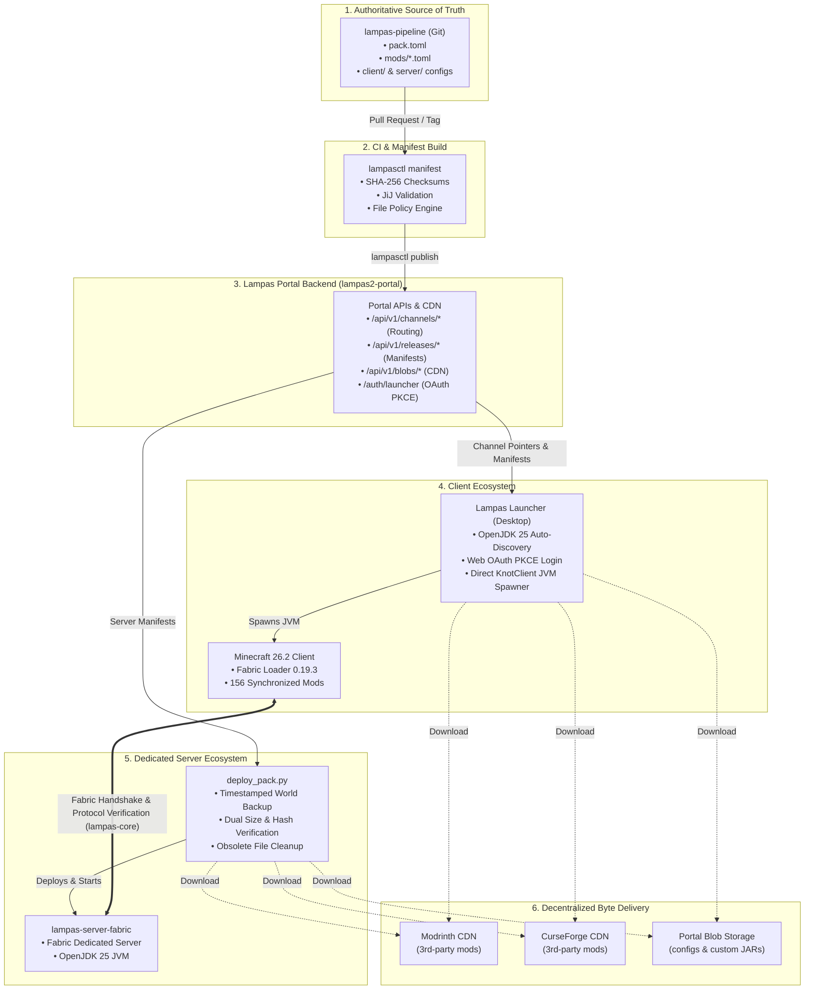

# ⚡ Lampas Modpack Distribution Pipeline

[](https://minecraft.net)
[](https://fabricmc.net)
[-orange.svg)](https://adoptium.net)
[](https://bun.sh)
[](LICENSE)

The **Lampas Pipeline** is a declarative, immutable Minecraft modpack distribution engine and release automation framework designed for high-performance SMP environments.

It guarantees **zero drift between clients and dedicated servers** by managing both from a single Git repository, eliminating runtime synchronization mods and third-party launcher dependencies.

---

## 🌟 Key Architecture & Tenets



1. **Deterministic Single Source of Truth**: Every client and server release is strictly generated from declarative TOML descriptors committed to Git.
2. **Decentralized Byte Delivery**: Third-party mod binaries are streamed directly from original CDNs (Modrinth / CurseForge), while Lampas-owned configs and custom mods are served via the Lampas Portal content-addressed blob CDN.
3. **Standalone Desktop Launcher**: 100% independent of PrismLauncher, CurseForge App, or MultiMC. Bundles automatic **OpenJDK 25 (`java-runtime-epsilon`)** discovery and direct `KnotClient` JVM execution.
4. **Web OAuth2 PKCE Authentication**: Desktop login delegates to the web portal via a browser loopback OAuth2 flow, linking Discord roles, SMP whitelist verification, and official Minecraft Java UUIDs in one click.
5. **Zero-Downtime Rollbacks & Gated Channels**: Channels (`stable`, `beta`, `dev`) use immutable pointer updates for instantaneous release promotion or rollback.
6. **Automated Upstream Updater**: Scheduled CI jobs monitor all 150+ pack mods and automatically open Pull Requests with changelogs when updates are released.

---

## 📁 Repository Structure

```text
lampas-pipeline/
├── pack/
│   ├── pack.toml                 # Root pack descriptor (MC 26.2, Fabric 0.19.3, Pack v2.0.0, [launcher.play], [launcher.resourcepacks])
│   ├── pack.lock.json            # Lockfile with pinned upstream version IDs & SHA-256 hashes
│   ├── mods/                     # 150+ declarative mod TOML definitions
│   ├── resourcepacks/            # Declarative resource pack TOML definitions (e.g. lampas.toml)
│   ├── common/                   # Shared configs, scripts, and assets (synced to both client & server)
│   ├── client/                   # Client-only mods and configs
│   ├── server/                   # Server-only mods and configs
│   └── custom/                   # Packaged custom override JARs (e.g. lampas2-overrides)
│
├── launcher/                     # Standalone Electron Desktop Launcher
│   ├── src/                      # TypeScript main, preload, JVM executor, & sync engine
│   ├── ui/                       # Modern dark-mode UI with live console & RAM allocation slider
│   └── package.json              # Electron-builder configuration (NSIS .exe, AppImage)
│
├── tools/lampasctl/              # High-performance pipeline CLI (Bun + TypeScript)
│   └── src/
│       ├── checker.ts            # Concurrent upstream update checker for Modrinth/CurseForge
│       ├── diff.ts               # Release & manifest visual diff tool
│       ├── manifest.ts           # Manifest builder for client/server distribution
│       ├── resolver.ts           # Upstream API dependency resolver
│       ├── validator.ts          # Fabric metadata & JiJ integrity validator
│       └── sync.ts               # Headless installation and sync engine
│
├── manifest/                     # Generated release artifacts
│   ├── client-manifest.json      # Client distribution manifest
│   ├── server-manifest.json      # Dedicated server distribution manifest
│   └── release.json              # Release metadata & channel descriptor
│
└── .github/workflows/
    ├── validate-pack.yml         # PR automated smoke testing & lockfile validation
    ├── release-pack.yml          # Git tag release compiler & portal publisher
    └── update-check.yml          # Daily cron job for upstream mod update PRs
```

---

## 🛠️ CLI Tooling (`lampasctl`)

`lampasctl` is the single CLI driving pack maintenance, validation, and deployment.

### 1. 1-Click Mod Management (`add` & `remove`)
Add or remove mods directly from the command line. Automatically detects project metadata, fetches latest compatible releases for Minecraft 26.2, updates `pack/mods/*.toml`, updates `pack.lock.json`, and rebuilds manifests in one step:

```bash
# Add a Modrinth mod (by slug, ID, or web URL)
bun run lampasctl add appleskin --side client
bun run lampasctl add 5sy6g3kz --side both
bun run lampasctl add https://modrinth.com/mod/sodium --side client

# Add a CurseForge mod (URL auto-detection, slug, project ID, or pinned file URL)
bun run lampasctl add https://www.curseforge.com/minecraft/mc-mods/appleskin
bun run lampasctl add appleskin --provider curseforge --side client
bun run lampasctl add 248787 --provider curseforge --version 5604145
bun run lampasctl add https://www.curseforge.com/minecraft/mc-mods/appleskin/files/5604145

# Add a custom local JAR
bun run lampasctl add ./my-custom-mod.jar --side both

# Remove a mod and re-synchronize manifests
bun run lampasctl remove appleskin
```

CurseForge authoring commands require a Core API key. Put it in the process environment or an ignored local `.env`
file; the key is used only by `lampasctl add`, `resolve`, `enrich`, and `check-updates` and is never written to pack
descriptors, lockfiles, or manifests:

```dotenv
CURSEFORGE_API_KEY=replace-with-your-curseforge-core-api-key
```

CurseForge artifacts remain on the upstream CDN. During resolution, `lampasctl` verifies the upstream SHA-1 and file
size, calculates the SHA-256/SHA-512 hashes required by Lampas, and keeps a verified local copy under the ignored
`.lampas/cache/curseforge/` directory. Projects that disable third-party distribution must be downloaded manually and
added as a local JAR instead.

### 2. Daily Upstream Update Checker
Scan all pack mods concurrently against Modrinth / CurseForge APIs:
```bash
# Check for newer compatible releases on Minecraft 26.2
bun run lampasctl check-updates

# Automatically apply updates to pack/mods/*.toml
bun run lampasctl check-updates --apply

# Export Markdown changelog (used in GitHub Actions)
bun run lampasctl check-updates --markdown update_summary.md
```

### 3. Lockfile & Manifest Generation
```bash
# Resolve all TOML descriptors into pack.lock.json
bun run lampasctl resolve

# Validate Fabric metadata, dependencies, and environment constraints
bun run lampasctl validate

# Build client-manifest.json and server-manifest.json
bun run lampasctl manifest
```

### 3. Release Diff Tool
Compare two manifests to inspect added, removed, or updated mods along with size deltas:
```bash
bun run lampasctl diff --from manifest/client-manifest.json --to manifest/server-manifest.json
```

### 4. Portal Release Publishing
Publish a release and upload configs/custom blobs to [`lampas2-portal`](https://github.com/justbecauseph/lampas2-portal):
```bash
bun run lampasctl publish --portal http://localhost:3000 --channel stable --secret <PUBLISH_TOKEN>
```

### 5. Headless Client / Server Sync
```bash
bun run lampasctl install --manifest manifest/client-manifest.json --target ./my-instance

# Force a complete SHA-256 verification instead of the metadata fast path
bun run lampasctl install --manifest manifest/client-manifest.json --target ./my-instance --verify full
```

Normal installs use the `fast` verification mode, which trusts unchanged size and modification-time metadata recorded in `.lampas/installation.json`. Use `--verify full` (or the launcher's Repair action) to hash every managed file.

---

## 🌐 Direct Connect & Required Resource Packs

Lampas releases can declaratively configure automatic server connection and required resource packs directly in `pack/pack.toml`:

```toml
[launcher.play]
auto_connect = true
server = "play.lampas.gg:25565"

[launcher.resourcepacks]
required = ["lampas"]
```

### Resource Pack Definitions

Resource packs are declared under `pack/resourcepacks/`:

```text
pack/
├── pack.toml
├── resourcepacks/
│   └── lampas.toml
```

Example `pack/resourcepacks/lampas.toml`:
```toml
name = "Lampas Official Resources"
side = "client"
type = "resourcepack"

[provider]
type = "direct"
url = "https://cdn.lampas.gg/resources/Lampas-Resources-2.0.0.zip"
sha256 = "e3b0c44298fc1c149afbf4c8996fb92427ae41e4649b934ca495991b7852b855"
filename = "Lampas-Resources-2.0.0.zip"
size = 1048576
```

### Managed vs. Required Resource Packs

- **Managed Resource Packs**: Any resource pack resolved in `pack.lock.json` and distributed to `resourcepacks/`. It is synchronized and kept up to date by the pipeline and launcher.
- **Required Resource Packs**: Defined in `[launcher.resourcepacks] required = ["<artifact-id>"]`. A required pack is synchronized **and automatically enabled** in Minecraft's `options.txt` prior to launch. If the player disables, deletes, or modifies it, the launcher safely re-enables or repairs it without altering any user-installed custom resource packs or player settings.

### Direct Connect Auto-Connection

When `[launcher.play] auto_connect = true` and a vlampas.towner address is configured:
- The launcher UI indicates the connection target directly beneath the **PLAY** button (`Connecting to: play.lampas.gg:25565`).
- The game runner launches modern Minecraft Java Edition passing `--quickPlayMultiplayer <server>` to instantly join the server on boot without requiring client-side mods.

### Server-Side Resource Pack Enforcement

When generating release manifests (`lampasctl manifest`), the pipeline automatically exports:
- `manifest/server-resource-pack.properties` containing `resource-pack=<url>`, `resource-pack-sha1=<sha1>`, and `require-resource-pack=true` for vanilla dedicated servers.
- `manifest/server-resource-pack.json` for custom server plugins and backend infrastructure.

---

## 🎮 Desktop Launcher

The desktop launcher is built with **Electron + TypeScript** and packaged with **`electron-builder`**.

### Features:
- **Zero Third-Party Dependencies**: Completely standalone. No PrismLauncher, MultiMC, or vanilla launcher required.
- **Embedded OpenJDK 25 Discovery**: Auto-detects local Java 25 or seamlessly provisions Mojang's official `java-runtime-epsilon` on first boot.
- **One-Click Portal Login**: Single unified login button using OAuth2 PKCE via the default web browser.
- **Built-in Console**: Real-time log streaming with search and error highlighting.
- **Channel Switching**: Instant switching between `Stable`, `Beta`, and `Dev` channels based on player roles.

### Running Locally:
```bash
cd launcher
bun install
bun run start
```

### Packaging Binaries:
```bash
cd launcher

# Package unpacked directory for testing
bun run package:dir

# Build Windows 1-Click NSIS Installer (.exe) & Portable Executable
bun run package:win

# Build Linux AppImage / tar.gz
bun run package:linux
```

---

## 🖥️ Dedicated Server Deployment (`deploy_pack.py`)

Dedicated servers synchronize using the self-contained, dependency-free Python deployment engine:

```bash
# Full deployment with automatic timestamped world backup
python deploy_pack.py

# Skip backup (for automated CI/CD runs)
python deploy_pack.py --skip-backup

# Deploy directly from a remote Lampas Portal instance
python deploy_pack.py --portal-url https://portal.lampas.gg --channel stable
```

### Safeguards:
- **Chunked Streaming**: Downloads are streamed in 64 KB chunks directly to temporary files.
- **Dual Validation**: Validates both total byte count and SHA-256 hash before replacing files.
- **Automatic Recovery**: Corrupted or truncated files (e.g. 1 KB network aborts) are detected on disk and automatically re-downloaded.
- **Protected Paths**: Never overwrites `world/`, `server.properties`, `whitelist.json`, `ops.json`, or player logs.

---

## 🔒 Custom Protocol Mod (`lampas-core`)

Packaged inside `lampas2-overrides`, **`lampas-core`** provides protocol verification:
- On multiplayer join, the client transmits a `lampas:handshake_c2s` payload with its pack semantic version.
- The server validates the version against its required release.
- If a mismatch is detected, the server displays an informative disconnection prompt directing the player to launch their Lampas Launcher to auto-update.

---

## 🤖 CI/CD Automation

- **[`validate-pack.yml`](file:///.github/workflows/validate-pack.yml)**: Validates every pull request, ensuring all mod descriptors resolve, dependencies match, and hashes verify.
- **[`release-pack.yml`](file:///.github/workflows/release-pack.yml)**: Triggers on Git tags (`v*`). Builds manifests, compiles Windows and Linux launcher binaries, uploads release artifacts, and publishes the release to the Lampas Portal.
- **[`update-check.yml`](file:///.github/workflows/update-check.yml)**: Daily cron job checking upstream mod repositories for Minecraft 26.2 updates and opening automated PRs. Configure the repository secret `CURSEFORGE_API_KEY` before adding CurseForge-backed descriptors.

---

## 📄 License

This repository is licensed under the **MIT License**. Mod binaries and assets belong to their respective creators under their individual licenses.
